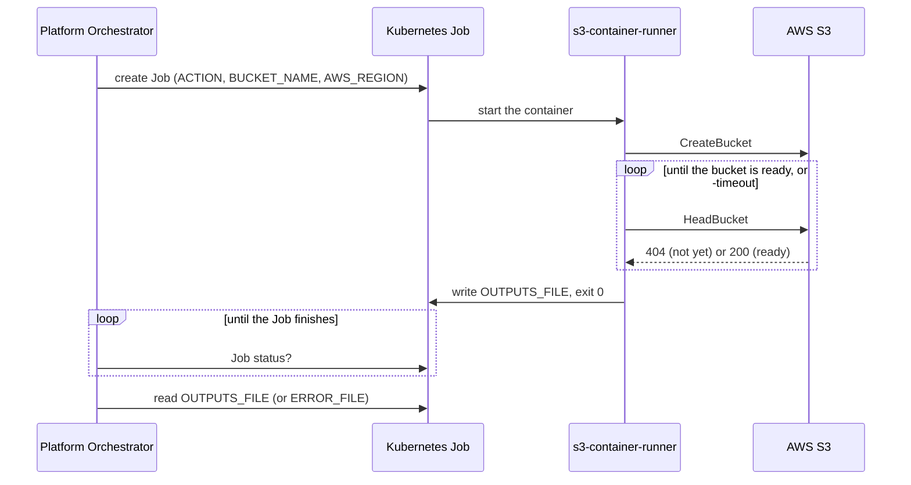

# s3-container-runner

A container image that creates or destroys an AWS S3 bucket. It calls the S3 API directly with `aws-sdk-go-v2`, without Terraform or the AWS CLI. The Humanitec Operator's built-in Container Driver (`humanitec/container-builtin`) runs it as a Kubernetes Job inside your cluster.

[`examples/s3-resource-definition.yaml`](examples/s3-resource-definition.yaml) is a complete Resource Definition that uses it.

## How the async flow works

The runner is a plain blocking program. It doesn't know about queues, callbacks or retries:

1. Call the S3 API (`CreateBucket` or `DeleteBucket`).
2. Poll `HeadBucket` in a loop until the bucket exists (create) or is gone (destroy). Each attempt is logged.
3. Write the outputs to a file and exit `0`. On failure, write the error to a file and exit `1`.

The Platform Orchestrator makes this asynchronous. On each deployment, the Container Driver creates a Kubernetes Job (with `backoffLimit: 0`) that runs the image. The orchestrator then polls the Job until it finishes, and reads the outputs file, or the error file, from the shared directory. A slow cloud API doesn't block the deployment pipeline. A failed run fails the resource, and the orchestrator decides what to do next.



## Runtime contract

The Container Driver talks to the runner only through environment variables and files:

| Env var | Meaning |
| --- | --- |
| `ACTION` | `create` or `destroy`. Required, no default. |
| `SCRIPTS_DIRECTORY` | Shared directory. The runner enters it first, so relative paths resolve against it. |
| `OUTPUTS_FILE` | Where the outputs are written (create only). |
| `ERROR_FILE` | Where the error is appended on failure. The runner then exits 1. |

Both files are written with mode `0600`, and the runner won't follow a symlink there. `RESOURCE_INPUTS_FILE` and `SECRET_OUTPUTS_FILE` are ignored.

Flag: `-timeout` (default `5m`) bounds the whole run, polling included. `SIGTERM` and `SIGINT` stop it cleanly.

## Inputs

These are set by the Resource Definition as Job variables (`driver_inputs.values.job.variables`):

| Variable | Required | Notes |
| --- | --- | --- |
| `BUCKET_NAME` | yes | Generated once by the Definition's `templates.init` and kept in its state. The runner never generates names. |
| `AWS_REGION` | yes | Region of the bucket. |
| `AWS_CREDENTIALS_FILE` | no | Path of a secret file with static credentials, see below. Relative paths resolve against `SCRIPTS_DIRECTORY`. |

Credentials:

- If `AWS_CREDENTIALS_FILE` is set, the runner uses the static credentials in it: `{"access_key_id": "...", "secret_access_key": "..."}`. Deliver the file through the Definition's `secret_refs.files` (see the commented block in the example). Don't use Job variables: they end up as plain values in the Job spec. Session tokens aren't supported, because temporary credentials would expire in the secret store; use a long-lived IAM user key.
- Otherwise, the runner uses the standard AWS default credential chain. In the cluster, that is the Job's `service_account`, bound to an IAM role through IRSA or EKS Pod Identity.

Errors about the credentials file never include its content.

## Outputs

On create, `OUTPUTS_FILE` is:

```json
{"bucket": "<BUCKET_NAME>", "region": "<AWS_REGION>", "arn": "arn:aws:s3:::<BUCKET_NAME>"}
```

Destroy writes no outputs. There are no secret outputs.

## Behaviour

### create

- `CreateBucket`, with a `LocationConstraint` unless the region is `us-east-1`.
- If the bucket already exists in your account (`BucketAlreadyOwnedByYou`), that counts as success. The Job runs again on every deployment.
- If another account owns the name (`BucketAlreadyExists`), the run fails. Bucket names are global.
- Polls `HeadBucket` until it returns 200: 404 means not yet, anything else is an error. The wait starts at 1s and doubles up to 10s.

### destroy

- Empties the bucket: lists the objects page by page (at most 1000 keys per page) and deletes each page with one `DeleteObjects` call. A key that fails to delete fails the run.
- `DeleteBucket`. A bucket that is already gone (`NoSuchBucket`) counts as success.
- Polls `HeadBucket` until it returns 404.

Out of scope: bucket policies, versioning, encryption and lifecycle configuration. On a versioned bucket, destroy deletes only the current objects, so `DeleteBucket` fails.

## IAM permissions

The role behind the Job's service account needs:

| Action | Used by |
| --- | --- |
| `s3:CreateBucket` | `CreateBucket` |
| `s3:ListBucket` | `HeadBucket`, `ListObjectsV2` |
| `s3:DeleteObject` | `DeleteObjects` |
| `s3:DeleteBucket` | `DeleteBucket` |

Scoped to the name prefix used in the example definition:

```json
{
  "Version": "2012-10-17",
  "Statement": [
    {
      "Effect": "Allow",
      "Action": ["s3:CreateBucket", "s3:ListBucket", "s3:DeleteBucket"],
      "Resource": "arn:aws:s3:::hum-*"
    },
    {
      "Effect": "Allow",
      "Action": "s3:DeleteObject",
      "Resource": "arn:aws:s3:::hum-*/*"
    }
  ]
}
```

## Development

| Target | What it does |
| --- | --- |
| `make build` | Builds `bin/s3-container-runner` (`VERSION` is stamped into the binary and logged at start) |
| `make test-unit` | `go test -race -cover ./...` |
| `make test-integration` | Builds the image, then runs the unit and integration tests (needs Docker) |
| `make lint` | `golangci-lint run`, pinned in `tools/go.mod`, including the integration-tagged code |
| `make fmt` | `golangci-lint fmt` |
| `make image` | Builds `ghcr.io/humanitec-architecture/s3-container-runner:$(VERSION)` (needs Docker) |
| `make clean` | Removes `bin/` and the image built by `make image` |

Code layout:

- [`cmd/s3-container-runner/main.go`](cmd/s3-container-runner/main.go): the whole flow in `run`, step by step (call the API, poll, write outputs), plus flags, environment, logging and error reporting.
- [`cmd/s3-container-runner/s3.go`](cmd/s3-container-runner/s3.go): everything AWS: the client and its credentials, create, destroy and the polling loop, behind a small `s3API` interface.
- [`internal/contract/`](internal/contract): the Container Driver contract (env vars, outputs file, error file).

Unit tests use a fake `s3API`. They cover the polling loop, create, destroy (with pagination and per-key errors) and the contract.

Integration tests live in [`test/integration/`](test/integration) behind the `integration` build tag. They start [moto](https://github.com/getmoto/moto), a free S3 emulator, with testcontainers and run the image from `RUNNER_IMAGE` on the same Docker network, with the same environment the Container Driver sets. Then they check the exit code, the output and error files, and the bucket's state through a separate S3 client. When `AWS_ENDPOINT_URL_S3` is set, the runner switches to path-style addressing, which the emulator needs. This is the only emulator-specific code in the runner.

Moto ignores the credentials' values and serves every request from one default account. The test that needs a bucket owned by another account creates it with the `x-moto-account-id` header, from the test's own client.

LocalStack isn't used: since March 2026 its image needs an auth token tied to a LocalStack account to start.

## Publishing

CI ([`.github/workflows/ci.yaml`](.github/workflows/ci.yaml)) runs lint, unit tests and integration tests on every push and pull request.

Pushing a semver tag such as `v0.1.0` also builds the image for `linux/amd64` and `linux/arm64`, and pushes it as `ghcr.io/humanitec-architecture/s3-container-runner:0.1.0`. A stable tag also updates `latest`.

```sh
git tag v0.1.0 && git push origin v0.1.0
```

To push by hand instead:

```sh
make image VERSION=0.1.0
docker push ghcr.io/humanitec-architecture/s3-container-runner:0.1.0
```

The package is public on ghcr.io: `ghcr.io/humanitec-architecture/s3-container-runner`.

## License

Licensed under the [Apache License 2.0](LICENSE).
